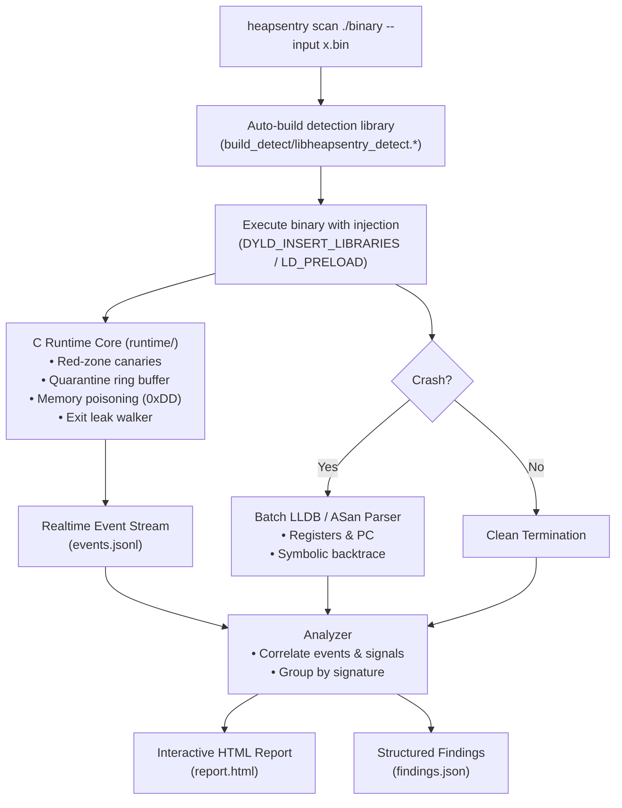

# HeapSentry — Unified Memory-Safety Scanner & Triage Engine

HeapSentry is an all-in-one defensive memory-safety scanner and crash triage engine. It combines a dynamic interposition C runtime with an automated Python orchestrator to detect heap buffer overflows, double-frees, use-after-free writes, and memory leaks in compiled binaries without recompilation, generating self-contained visual HTML and JSON reports in a single command.

---

## Capabilities

| Vulnerability Class | Detection Mechanism | Severity |
|---|---|---|
| **Heap Buffer Overflow (OOB Write)** | 16-byte left and right canaries (`0xFEEDFACEDEADBEEF`). Canary corruption on `free()` reports the exact corrupted bytes, overflow side (`left`/`right`), fault address, and allocation size. | `CRITICAL` |
| **Double-Free** | 512-slot quarantine ring buffer. Intercepts duplicate `free()` calls before they reach the system allocator, preventing heap corruption. | `CRITICAL` |
| **Use-After-Free (UAF) Write** | Memory poisoning on free (`0xDD`). Stamped bytes expose subsequent writes into freed buffers. | `HIGH` |
| **Memory Leaks** | Live allocation tracking in an open-addressing table. Process exit walk logs un-freed allocations with their size and address. | `MEDIUM` |
| **Abnormal Crashes** | Captures fatal signals (`SIGSEGV`, `SIGBUS`, `SIGABRT`, `SIGILL`, `SIGFPE`, `SIGTRAP`) and NTSTATUS crash codes. | `HIGH` |

---

## Quickstart

### 1. Environment Check
Validate compiler availability, LLDB presence, and dynamic library injection capabilities:
```bash
PYTHONPATH=src python3 -m heapsentry doctor
```

### 2. Scan a Single Binary
Run a target binary against a test input:
```bash
PYTHONPATH=src python3 -m heapsentry scan ./your_binary --input payload.bin --out results/
```
Output:
```text
Scan complete. 1 run. 2 finding(s): 1 critical, 1 medium.
Report: results/report.html
```

### 3. Scan an Entire Corpus in Parallel
Run a directory of seed inputs (e.g. from a fuzzer or test corpus) across multi-threaded workers:
```bash
PYTHONPATH=src python3 -m heapsentry scan ./your_binary --input-dir corpus/ --workers 4 --out results/
```

### 4. Open the Visual Report
Open the self-contained HTML report in any browser:
```bash
open results/report.html
```

---

## How It Works



1. **Dynamic Interposition**: HeapSentry transparently intercepts `malloc`, `free`, `realloc`, and `calloc` via `DYLD_INSERT_LIBRARIES` on macOS (with full `DYLD_INTERPOSE` and `malloc_size` handling) or `LD_PRELOAD` on Linux.
2. **Deterministic Red Zones**: Each allocation is padded with embedded canaries. Out-of-bounds writes are caught at deallocation.
3. **Quarantine & Poisoning**: Blocks are poisoned with `0xDD` and held in quarantine to safely catch double-frees and UAF writes.
4. **Crash Backtraces**: When a fatal signal occurs, LLDB is automatically invoked in non-interactive batch mode to capture register dumps and symbolicated stack traces.
5. **Standalone Reporting**: Generates a zero-dependency HTML report containing finding cards, interactive allocation timelines, and raw evidence inspection.

---

## CLI Reference

### `heapsentry scan`
Executes one or more target runs and generates reports.

```text
usage: heapsentry scan [-h] [--input FILE] [--input-dir DIR] [--out DIR]
                       [--report FILE] [--timeout SEC] [--workers N]
                       [--no-build] [--quiet] [--args ARG [ARG ...]]
                       binary

positional arguments:
  binary             Path to the target binary to scan.

options:
  --input FILE       Input file to feed to the target via stdin.
  --input-dir DIR    Directory of seed inputs (corpus mode).
  --out DIR          Directory to store run artifacts (default: heapsentry_out).
  --report FILE      Custom path for the HTML report (default: <out>/report.html).
  --timeout SEC      Per-run execution timeout in seconds (default: 10.0).
  --workers N        Number of parallel worker processes in corpus mode (default: 1).
  --no-build         Skip auto-compiling the detection dynamic library.
  --quiet            Suppress stdout progress indicators.
  --args ARG ...     Extra command-line arguments passed to the target binary.
```

### `heapsentry report`
Re-renders visual HTML reports from an existing scan directory:
```bash
PYTHONPATH=src python3 -m heapsentry report heapsentry_out/ --out new_report.html
```

### `heapsentry doctor`
Verifies environment dependencies:
```bash
PYTHONPATH=src python3 -m heapsentry doctor
```

---

## Output Structure

Every run creates a structured output directory:

```text
results/
├── report.html                    # Visual self-contained HTML report
├── <run_id>/
│   ├── findings.json              # Prioritized findings array
│   ├── events.jsonl               # Chronological allocation/deallocation timeline
│   ├── stdout.txt                 # Target standard output
│   ├── stderr.txt                 # Target standard error (including ASan logs)
│   ├── backtrace.txt              # Symbolic LLDB stack trace (on crash)
│   └── input.bin                  # Exact reproduction input bytes
```

---

## Repository Map

| Directory / File | Description |
|---|---|
| [`runtime/`](runtime/) | C detection engine: red-zone canaries, quarantine, leak tracking, JSONL logger. |
| [`src/heapsentry/`](src/heapsentry/) | Python unified engine: CLI, scanner, event parser, analyzer, LLDB bridge, HTML report. |
| [`src/crashlab/`](src/crashlab/) | Standalone crash classification, NTSTATUS normalization, and ASan parsing engine. |
| [`targets/`](targets/) | Controlled test targets demonstrating memory-safety vulnerabilities. |
| [`corpus/`](corpus/) | Seed inputs exercising normal runs, overflows, UAFs, double-frees, and timeouts. |
| [`tests/`](tests/) | Unit and end-to-end integration test suite. |
| [`Makefile.heapsentry`](Makefile.heapsentry) | Dedicated build driver for the detection dynamic library. |
| [`pyproject.toml`](pyproject.toml) | Package metadata, entry points (`heapsentry`, `crashlab`), and pytest configuration. |

---

## Development & Testing

Run the full automated test suite:
```bash
python -m pip install -e ".[dev]"
pytest tests/
```

Build the C detection library directly:
```bash
make -f Makefile.heapsentry library
```

---

## License

MIT License. Designed for authorized defensive research and memory-safety analysis.
